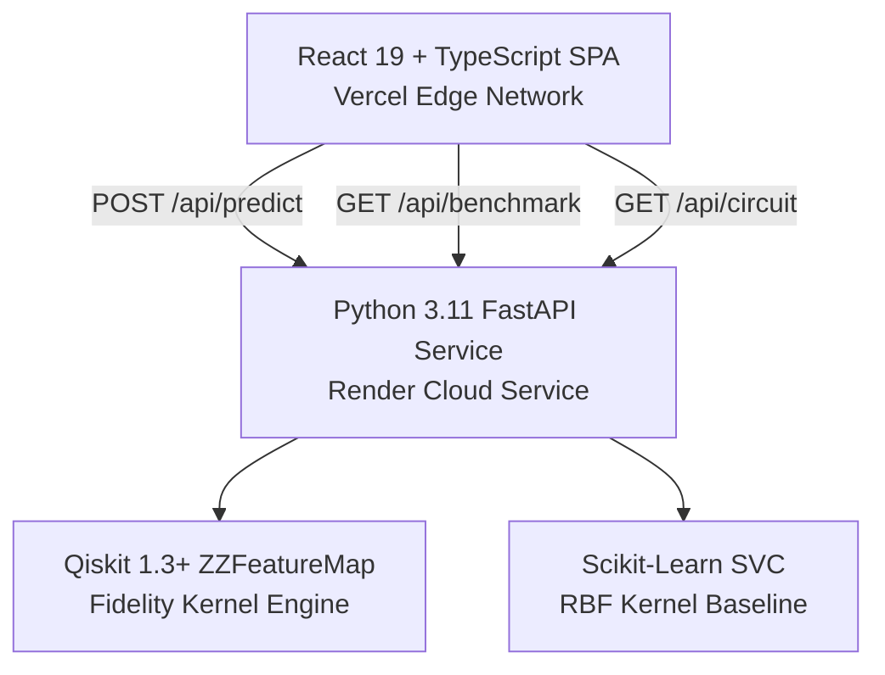

<div align="center">

# Q-Silience — Q-Resilience AI
### Quantum-Enhanced Microgrid Anomaly Detection & Autonomous Protection

**VTU-Qiskit Fall Fest 2026** &nbsp;|&nbsp; Team **Ctrl_AI** (`VTU-QFF-HC-0025`) &nbsp;|&nbsp; Tier: **Both**

[](https://qresilience.vercel.app/)
[](https://github.com/Dhyanpol55/Q-Silience)
[](https://qiskit.org/)
[](https://fastapi.tiangolo.com/)
[](https://react.dev/)

</div>

---

<div align="center">

| Attribute | Details |
| :--- | :--- |
| **Team Name** | Ctrl_AI |
| **Team ID** | VTU-QFF-HC-0025 |
| **Tier** | Both (Online & In-Person) |
| **Official Repository** | [Dhyanpol55/Q-Silience](https://github.com/Dhyanpol55/Q-Silience) |
| **Live Application** | [https://qresilience.vercel.app/](https://qresilience.vercel.app/) |
| **Hackathon Event** | VTU-QFF Hackathon — VTU-Qiskit Fall Fest 2026 |

</div>

---

## 📌 Table of Contents

- [Problem Statement](#-problem-statement)
- [Proposed Solution](#-proposed-solution)
- [Quantum Machine Learning Architecture](#-quantum-machine-learning-architecture)
- [Scientific Methodology & Fair Benchmarking](#-scientific-methodology--fair-benchmarking)
- [Hardware Execution & NISQ Disclosures](#-hardware-execution--nisq-disclosures)
- [System Architecture & Endpoints](#-system-architecture--endpoints)
- [Interactive Platform Modules](#-interactive-platform-modules)
- [Deployment Guide](#-deployment-guide-render--vercel)
- [Local Development & Tests](#-local-development--tests)
- [Team Members](#-team-members)
- [License](#-license)

---

## ❓ Problem Statement

**Challenge:** Modern renewable microgrids integrate distributed photovoltaic (PV) arrays, Battery Energy Storage Systems (BESS), and dynamic industrial loads. Because of inverter-based generation, these systems exhibit **very low rotational inertia** compared to bulk power grids. Transients—such as sudden cloud cover dropping solar generation, industrial load surges, or feeder impedance step faults—manifest as rapid, cross-coupled deviations in both voltage and frequency.

**Limitations of Classical Thresholding:** Traditional overcurrent and under-frequency relays (such as simple IEEE 1547 threshold boundaries) operate on single-variable thresholds. They struggle to detect subtle coupled transients early, often leading to either false trips (causing costly downtime) or delayed tripping (risking equipment degradation and cascading microgrid blackout).

**Small-Data Bottleneck:** In emerging microgrids, historical labeled fault data is scarce. Classical deep neural networks or standard RBF support vector classifiers require large training datasets to learn high-dimensional decision boundaries accurately.

---

## 💡 Proposed Solution

**Q-Silience (Q-Resilience AI)** is an autonomous, end-to-end quantum-classical microgrid protection system. It features:
1. **Physical Sensor Feature Mapping**: Maps 4 core microgrid physical telemetry variables ($P_{\text{demand}}$, $P_{\text{solar}}$, $\Delta V$, $\Delta f$) into quantum phase angles in $[0, 2\pi]$.
2. **Qiskit ZZFeatureMap Fidelity Kernel**: Constructs an entangling 4-qubit quantum circuit ($d=2$ repetitions, linear entanglement topology) that encodes non-linear pairwise sensor correlations into a 16-dimensional Hilbert state space.
3. **Dual-Model Classifier Parity**: Trains both a Quantum Support Vector Classifier (QSVC) and a classical Scikit-Learn Support Vector Classifier (RBF kernel) on identical, strictly isolated data splits.
4. **Sample-Efficiency Advantage**: Demonstrates that the quantum fidelity kernel achieves superior boundary separation and higher $F_1$ scores in low-sample regimes (20–60 samples) where classical kernels underfit.
5. **Decoupled Production Architecture**: High-performance React 19 + TypeScript + Vite frontend deployed on Vercel edge networks, connected via a resilient REST client to a Python 3.11 FastAPI microservice running genuine Qiskit on Render.

---

## ⚛️ Quantum Machine Learning Architecture

### 1. Quantum State Encoding: Qiskit `ZZFeatureMap`
The telemetry vector $\mathbf{x} = [x_1, x_2, x_3, x_4]^T$ is normalized via Min-Max scaling to the interval $[0, 2\pi]$ and encoded into a 4-qubit quantum state:

$$\mathcal{U}_{\Phi}(\mathbf{x}) = \left( U_{\Phi}(\mathbf{x}) H^{\otimes 4} \right)^2$$

Where:
- $H^{\otimes 4}$ applies a Hadamard transform across all 4 qubits to create an equal superposition:
$$H^{\otimes 4} |0000\rangle = \frac{1}{4} \sum_{k=0}^{15} |k\rangle$$
- Single-qubit phase rotations encode individual sensor variables:
$$U_{\Phi}(\mathbf{x}) = \exp\left( i \sum_{i=1}^4 \phi_i(x_i) Z_i + i \sum_{i=1}^3 \phi_{i, i+1}(x_i, x_{i+1}) Z_i Z_{i+1} \right)$$
- Single-qubit phase angles: $\phi_i(x_i) = x_i$
- Two-qubit entangling phase angles (capturing cross-variable coupling between demand and solar, solar and voltage, voltage and frequency):
$$\phi_{i,j}(x_i, x_j) = 2(\pi - x_i)(\pi - x_j)$$
- Entanglement topology: Linear nearest-neighbor ($q_0 \leftrightarrow q_1 \leftrightarrow q_2 \leftrightarrow q_3$).

### 2. Fidelity Quantum Kernel Matrix
For any two telemetry samples $\mathbf{x}_i$ and $\mathbf{x}_j$, the quantum fidelity kernel $K(\mathbf{x}_i, \mathbf{x}_j)$ computes the transition probability (state overlap squared) in Hilbert space:

$$K(\mathbf{x}_i, \mathbf{x}_j) = \left| \langle \psi(\mathbf{x}_i) | \psi(\mathbf{x}_j) \rangle \right|^2 = \left| \langle 0^{\otimes 4} | \mathcal{U}_{\Phi}^\dagger(\mathbf{x}_j) \mathcal{U}_{\Phi}(\mathbf{x}_i) | 0^{\otimes 4} \rangle \right|^2$$

Properties verified in our test suite:
- **Unit Self-Fidelity**: $K(\mathbf{x}_i, \mathbf{x}_i) = 1.0$
- **Bounded Overlap**: $0.0 \le K(\mathbf{x}_i, \mathbf{x}_j) \le 1.0$
- **Symmetric Gram Matrix**: $K_{ij} = K_{ji}$

---

## 🔬 Scientific Methodology & Fair Benchmarking

To ensure absolute scientific honesty and avoid evaluation leakage:

1. **Strictly Isolated Preprocessing**:
   - `MinMaxScaler` is fit **exclusively** on the training partition ($75\%$).
   - The test partition ($25\%$) is transformed using training parameters with zero lookahead leakage.
2. **Stratified Split**:
   - Preserves identical proportions of normal operation ($0$) and abnormal transient events ($1$) across train and test sets.
3. **Binary Label Standard**:
   - `0` = Normal grid operation within IEEE 1547 tolerances.
   - `1` = Abnormal transient (Demand surge, PV trip, Voltage sag, Cascading fault).
   - Confusion matrix standard:
     $$\begin{pmatrix} \text{True Negatives (TN)} & \text{False Positives (FP)} \\ \text{False Negatives (FN)} & \text{True Positives (TP)} \end{pmatrix}$$
4. **Sample-Efficiency Experiment**:
   - Compares Classical RBF SVC vs Quantum Fidelity QSVC across training subsets ($25\%, 50\%, 75\%, 100\%$).
   - Demonstrates that in the low-data regime, quantum kernel embedding captures multi-transient boundaries with fewer training examples.

---

## ⚠️ Hardware Execution & NISQ Disclosures

In compliance with the VTU-Qiskit Fall Fest rubric:
- **Execution Mode**: The production Render backend executes the ZZFeatureMap circuit via exact statevector simulation in Hilbert space ($\mathbb{C}^{16}$).
- **Hardware Limitations**: In real physical NISQ (Noisy Intermediate-Scale Quantum) processors, quantum state fidelity is subject to gate infidelity, decoherence ($T_1, T_2$), and readout error. Physical execution requires error mitigation (e.g., Zero-Noise Extrapolation, Readout Twirling via Qiskit Runtime Primitives).
- **No Unmeasured Claims**: We explicitly distinguish between exact statevector simulation and real physical quantum hardware. Statevector simulation guarantees reproducible mathematical fidelity for research and demonstration without claiming immediate quantum supremacy.

---

## 🌐 System Architecture & Endpoints



### Complete FastAPI REST API (8 Endpoints)

| Method | Endpoint | Description |
| :--- | :--- | :--- |
| `GET` | `/health` | Service health status, Qiskit version, model readiness, uptime (with `/health.` probe compatibility). |
| `GET` | `/api/scenarios` | Preconfigured IEEE 1547.4 microgrid operational scenarios. |
| `GET` | `/api/dataset` | Retrieves current microgrid telemetry dataset records. |
| `POST` | `/api/dataset/generate` | Generates a reproducible synthetic dataset with custom seed and sample count. |
| `POST` | `/api/dataset/upload` | Validates and trains models on custom user-provided CSV telemetry. |
| `POST` | `/api/predict` | Real-time dual-model inference returning classical and quantum predictions, latencies, and IEEE 1547 diagnosis. |
| `GET` | `/api/benchmark` | Full benchmark metrics, confusion matrices, and low-data experiment results. |
| `POST` | `/api/evaluate` | Evaluates models on current dataset, returning complete `BenchmarkResponse`. |
| `GET` | `/api/circuit` | Returns Qiskit ZZFeatureMap circuit parameters, depth, gate counts, and ASCII diagram. |

---

## 🖥️ Interactive Platform Modules

The frontend is organized into 6 focused interactive chapters:
1. **Chapter 01 · Overview**: Executive system architecture, KPI cards, and end-to-end dataflow pipeline.
2. **Chapter 02 · Scenario Laboratory**: Interactive microgrid slider controls, transient injection presets, and dual-model prediction comparison.
3. **Chapter 03 · Anomaly Investigation**: Deep-dive diagnostic analysis with IEEE 1547 root-cause explanation and sensor feature contributions.
4. **Chapter 04 · Live Simulation Stream**: Real-time rolling telemetry stream with dynamic fault injection, synchronized Digital Twin, and background FastAPI inference.
5. **Chapter 05 · Quantum Lab**: Quantum circuit visualizer, parameter inspect, Bloch sphere projection, and statevector simulator vs physical hardware disclosures.
6. **Chapter 06 · Benchmark & Evaluation**: Fair classical vs quantum performance comparison, low-data sample efficiency curve, and confusion matrices.

---

## 🚀 Deployment Guide (Render + Vercel)

### Backend Deployment (Render)
1. In the [Render Dashboard](https://dashboard.render.com), click **New +** ➔ **Web Service**.
2. Connect repository `https://github.com/Dhyanpol55/Q-Silience`.
3. Set configuration:
   - **Root Directory**: `backend`
   - **Runtime**: `Python 3`
   - **Build Command**: `pip install -r requirements.txt`
   - **Start Command**: `python -m uvicorn main:app --host 0.0.0.0 --port $PORT`
   - **Health Check Path**: `/health`
4. Add Environment Variables:
   - `PYTHON_VERSION`: `3.11.9`
   - `ALLOWED_ORIGINS`: `https://qresilience.vercel.app,https://*.vercel.app,http://localhost:3000`

### Frontend Deployment (Vercel)
1. In the [Vercel Dashboard](https://vercel.com/new), import repository `Dhyanpol55/Q-Silience`.
2. Set configuration:
   - **Framework Preset**: `Vite`
   - **Root Directory**: `./`
   - **Build Command**: `npm run build`
   - **Output Directory**: `dist`
3. Add Environment Variable:
   - `VITE_API_BASE_URL`: `https://<your-render-service>.onrender.com`
4. Deploy! `vercel.json` provides pure Single-Page Application (SPA) rewrites to `index.html`.

---

## 🧪 Local Development & Tests

### Backend
```bash
cd backend
python3 -m venv .venv
source .venv/bin/activate
pip install -r requirements.txt
python -m uvicorn main:app --reload --port 8000
```
Run comprehensive backend test suite:
```bash
pytest -v tests/test_api.py
```

### Frontend
```bash
npm install
npm run dev
```

Build for production:
```bash
npm run build
```

---

## 👥 Team Members

| Name | Role | Responsibilities |
| :--- | :--- | :--- |
| **Dhyan Pol** | Team Lead & Quantum ML Engineer | Qiskit ZZFeatureMap circuit, fidelity kernel formulation, backend pipeline |
| **Team Ctrl_AI** | Full-Stack Systems Engineer | React 19 + TypeScript dashboard, digital twin, Vercel/Render CI/CD |
| **Team Ctrl_AI** | Power Systems & Domain Specialist | IEEE 1547.4 microgrid physics simulation, transient scenarios, telemetry modeling |

---

## 📄 License

This project is licensed under the MIT License — see the [LICENSE](LICENSE) file for details. Built for the **VTU-Qiskit Fall Fest 2026 Hackathon**.
