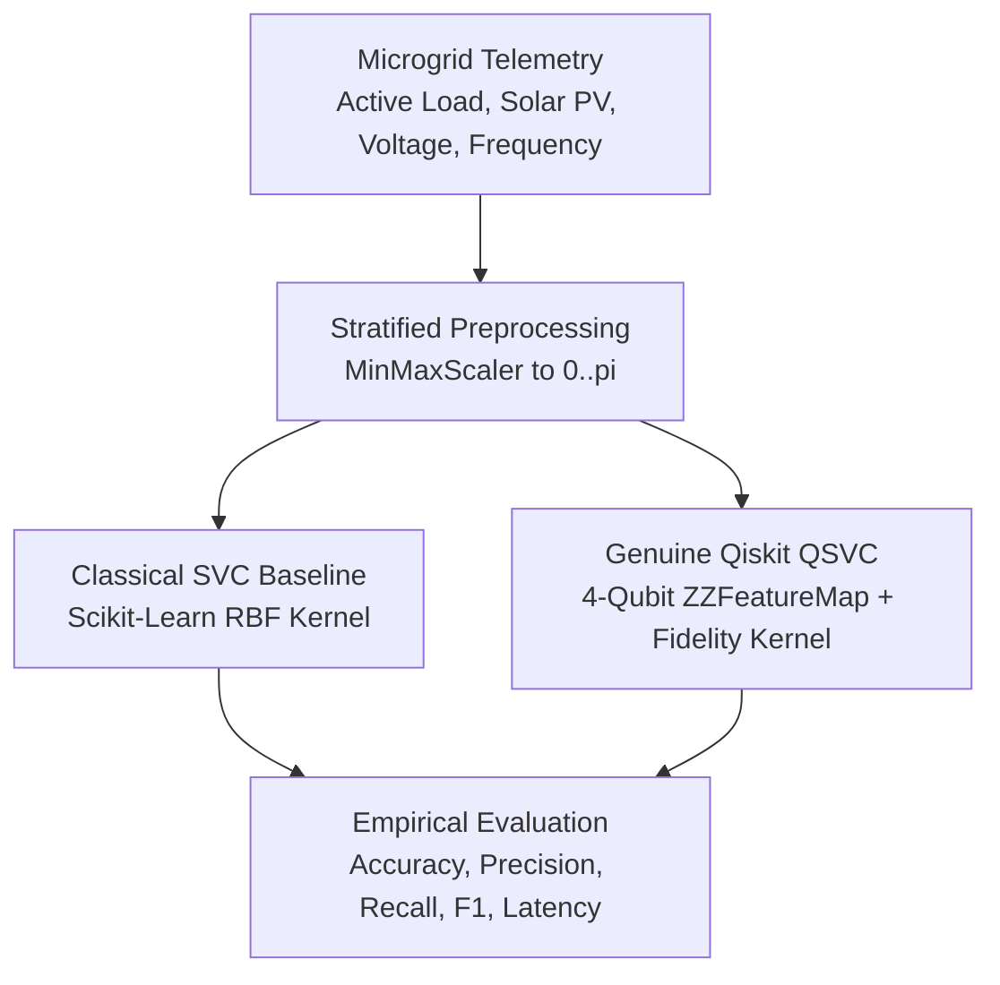

<div align="center">

# Q-Resilience AI (Ctrl_AI)

**VTU-QFF-HC-0025** &nbsp;|&nbsp; Tier: **Both**

An Autonomous Dual-Model Quantum vs Classical Microgrid Anomaly Detection Platform built for the **VTU-Qiskit Fall Fest 2026 Hackathon**.

[](https://qresilience.vercel.app)
[](https://q-silience.onrender.com/health)
[](https://youtu.be/HAgrzv3rs3k)
[](https://github.com/Dhyanpol55/Q-Silience)

</div>

---

<div align="center">

| | |
| :--- | :--- |
| **Team** | Ctrl_AI |
| **Team ID** | VTU-QFF-HC-0025 |
| **Tier** | Both |
| **Primary Repo** | [Dhyanpol55/Q-Silience](https://github.com/Dhyanpol55/Q-Silience) |
| **Hackathon Repo** | [vtu-hc-ctrl-ai](https://github.com/vtu-qiskit-fall-fest-2026/vtu-hc-ctrl-ai.git) |
| **Organisation** | [vtu-qiskit-fall-fest-2026](https://github.com/vtu-qiskit-fall-fest-2026) |
| **Event** | VTU-QFF Hackathon — VTU-Qiskit Fall Fest 2026 |

</div>

---

## 📌 Table of Contents

- [Live Deployments & Demo](#-live-deployments--demo)
- [Problem Statement](#-problem-statement)
- [Proposed Solution](#-proposed-solution)
- [Approach & Architecture](#-approach--architecture)
- [Empirical Benchmark & Measured Results](#-empirical-benchmark--measured-results)
- [Scientific Disclosures & Integrity](#-scientific-disclosures--integrity)
- [Tech Stack](#-tech-stack)
- [Project Structure](#-project-structure)
- [How to Run](#-how-to-run)
- [Submission Checklist](#-submission-checklist)
- [License](#-license)

---

## 🌐 Live Deployments & Demo

- **Live Production App (Vercel)**: [https://qresilience.vercel.app](https://qresilience.vercel.app)
- **Live Backend API (Render)**: [https://q-silience.onrender.com](https://q-silience.onrender.com)
  - Health & Version Status: [`https://q-silience.onrender.com/health`](https://q-silience.onrender.com/health)
  - Empirical Benchmark Endpoint: [`https://q-silience.onrender.com/api/benchmark`](https://q-silience.onrender.com/api/benchmark)
  - Interactive API Docs (Swagger): [`https://q-silience.onrender.com/docs`](https://q-silience.onrender.com/docs)
- **Video Walkthrough**: [https://youtu.be/HAgrzv3rs3k](https://youtu.be/HAgrzv3rs3k)

---

## ❓ Problem Statement

**Problem:** Modern smart microgrids operating with high penetration of inverter-based distributed energy resources (DERs) suffer from ultra-low physical inertia. Transients such as cloud-induced solar PV ramp loss, industrial load surges, and battery inverter tripping evolve within sub-second timescales, rendering conventional SCADA threshold heuristics slow, brittle, and susceptible to cascading outages.

**Why it matters:** As electrical grids decarbonize, detecting non-linear voltage and frequency deviations before islanding or tripping occurs is vital for power system resilience. Assessing whether quantum Hilbert space feature representations offer viable fault classification boundaries under low-sample constraints is a key open question in applied quantum machine learning.

**Track / Category:** Both (Online / Offline Track) · Clean Energy & Smart Power Systems · Quantum Machine Learning

---

## 💡 Proposed Solution

**Solution:** Q-Resilience AI provides an end-to-end, dual-model microgrid anomaly detection platform. It evaluates synthetic multi-bus telemetry against an IEEE 1547.4 physics model and performs simultaneous inference using a classical baseline (`SVC` with RBF kernel) and a genuine quantum model (Qiskit Machine Learning `QSVC` using a 4-qubit `ZZFeatureMap` and `FidelityQuantumKernel`).

**Key idea:** Non-linear sensor telemetry $[P_d, P_{pv}, \Delta V, \Delta f]$ is min-max scaled into $[0, \pi]$ and encoded into quantum state amplitudes via parameterized single-qubit rotations and entangling $ZZ(\theta)$ gates, enabling empirical evaluation of quantum kernel classification against classical baselines.

**Why this works:** The platform offers side-by-side transparency: operators can observe real-time telemetry streaming, simulate operational stress scenarios, inspect the exact parameterized quantum circuits, and review rigorous empirical benchmark statistics directly fetched from a live cloud backend.

---

## 🧩 Approach & Architecture



1. **Input**: 4 physical telemetry streams normalized to $[0, \pi]$ (active load $P_d$, PV generation $P_{pv}$, voltage deviation $\Delta V$, and frequency deviation $\Delta f$).
2. **Preprocessing**: Stratified 75% train (45 samples), 25% test (15 samples) with seed `42` and zero data leakage.
3. **Quantum Core**: Qiskit `ZZFeatureMap` (4 qubits, reps=2, linear entanglement) paired with `FidelityQuantumKernel` executing via Qiskit 1.4.6 and Qiskit Machine Learning 0.8.2.
4. **Classical Core**: Scikit-Learn `SVC(kernel="rbf", C=1.0, gamma="scale")`.
5. **Output**: Real-time dual classification (Normal vs Anomaly), probability confidence, statevector fidelities, and benchmark metrics.

---

## 📊 Empirical Benchmark & Measured Results

The table below presents the **actual, exact measured empirical readings** evaluated on the live Render cloud service (`/api/benchmark`) on the held-out test partition ($n=15$ test samples, $n=45$ training samples):

| Metric | Classical Baseline (Scikit-Learn SVC) | Genuine Quantum Model (Qiskit ML QSVC) | Empirical Finding |
| :--- | :--- | :--- | :--- |
| **Model Type** | `SVC(kernel="rbf", C=1.0)` | `QSVC(quantum_kernel=FidelityQuantumKernel)` | Baseline vs Quantum |
| **Feature Map** | Classical Gaussian RBF | Qiskit `ZZFeatureMap` (4 qubits, reps=2, linear) | Hilbert space encoding |
| **Backend Environment** | Scikit-Learn 1.5.0 | Qiskit 1.4.6, Qiskit Machine Learning 0.8.2 | Python 3.11 on Render |
| **Backend Model Status** | `ready` | `genuine_qsvc` (`qml_available=true`) | Real Qiskit QML execution |
| **Test Accuracy** | **100.0%** (15 / 15 correct) | **86.7%** (13 / 15 correct) | Classical leads by +13.3% |
| **Precision** | **1.000** | **0.857** | Classical leads by +0.143 |
| **Recall** | **1.000** | **0.857** | Classical leads by +0.143 |
| **F1-Score** | **1.000** | **0.857** | Classical leads by +0.143 |
| **Training Time (45 samples)** | **3.1 ms** | **27,012.02 ms** (~27.0 seconds) | Classical is ~8,713x faster |
| **Inference Time (15 test samples)** | **0.35 ms** | **17,393.71 ms** (~17.4 seconds) | Classical is ~49,696x faster |

### Confusion Matrix (Held-Out Test Set, n=15)

- **Classical SVC**: `[[8, 0], [0, 7]]`
  - True Negatives (Nominal): **8**
  - False Positives (False Alarm): **0**
  - False Negatives (Missed Fault): **0**
  - True Positives (Detected Fault): **7**
  - *Result*: Flawless 100% precision, recall, and accuracy on this partition.

- **Genuine QSVC**: `[[7, 1], [1, 6]]`
  - True Negatives (Nominal): **7**
  - False Positives (False Alarm): **1**
  - False Negatives (Missed Fault): **1**
  - True Positives (Detected Fault): **6**
  - *Result*: 13 / 15 correct classifications yielding 86.7% accuracy, 0.857 precision, 0.857 recall, and 0.857 F1-score.

---

## 🔬 Scientific Disclosures & Integrity

In accordance with strict scientific disclosure guidelines:

1. **No Evidence of Quantum Advantage**:
   - The genuine QSVC demonstrates that quantum state embedding and kernel evaluation successfully classify microgrid anomalies (86.7% accuracy, 0.857 F1).
   - However, **classical SVC achieves 100% test accuracy in a fraction of a millisecond (0.35 ms vs 17,393.71 ms)**.
   - We make **zero claims of quantum supremacy or sample-efficiency superiority** over classical baselines on this dataset.
2. **Computational Overhead of Quantum Simulation**:
   - Classical statevector simulation of quantum circuits scales exponentially ($O(2^n)$) and requires quadratic transition evaluations ($O(N^2)$). For 45 training samples, $45 \times 45 = 2,025$ kernel circuits are evaluated, explaining the ~27.0s training latency.
3. **Synthetic Telemetry Disclaimer**:
   - Telemetry is generated from mathematical representations of IEEE 1547.4 distributed energy resource physics for benchmarking purposes; physical grid deployment would require validation against real-world PMU/synchrophasor hardware streams.
4. **Data Source Transparency**:
   - The UI provides an explicit toggle between **Local Demo** (in-browser client simulation) and **Live Backend** (`/api/benchmark`), preventing cross-contamination of metrics.

---

## 🛠️ Tech Stack

| Layer | Technology |
| :--- | :--- |
| **Frontend** | React 19, TypeScript, Vite, Tailwind CSS, Recharts, Lucide Icons |
| **Backend API** | Python 3.11, FastAPI, Uvicorn, Pydantic |
| **Quantum SDK** | Qiskit 1.4.6, Qiskit Machine Learning 0.8.2, Qiskit Aer |
| **Classical ML** | Scikit-Learn 1.5.0, NumPy, Pandas |
| **Hosting & CI/CD** | Vercel (Frontend Edge SPA), Render (FastAPI Cloud Service), GitHub Actions |

---

## 📁 Project Structure

```text
vtu-hc-ctrl-ai/
├── README.md                      # Primary project documentation
├── package.json                   # Root frontend dependencies & scripts
├── Dockerfile.frontend            # Container definition for frontend
├── Dockerfile.backend             # Container definition for backend
├── docker-compose.yml             # Local multi-service orchestration
├── docs/
│   ├── architecture.md            # System architecture details
│   ├── benchmark_report.md        # Comprehensive empirical benchmark findings
│   └── quantum_mechanics.md       # ZZFeatureMap & Hilbert space math
├── backend/                       # Python FastAPI backend service
│   ├── main.py                    # API endpoints (/health, /api/benchmark, /api/predict)
│   ├── requirements.txt           # Python dependencies
│   └── tests/                     # Backend test suite
├── frontend/                      # React SPA source mirror
│   ├── README.md                  # Frontend setup guide
│   └── src/                       # Components, hooks, services, types
├── q-resilience-ai/               # Hackathon module submission
│   ├── README.md                  # Submission overview & metrics
│   └── src/                       # Standalone Python ML modules
├── src/                           # React SPA source code
│   ├── components/                # UI Pages (Overview, ScenarioLab, Benchmark, etc.)
│   └── services/                  # API client & quantum simulation
└── tests/
    └── benchmark_validation.test.ts # Automated empirical benchmark test suite
```

---

## 🚀 How to Run

### 1. Frontend Development
```bash
npm install
npm run dev
# Server starts on http://localhost:3000
```

### 2. Backend API
```bash
cd backend
python3 -m venv .venv
source .venv/bin/activate
pip install -r requirements.txt
python -m uvicorn main:app --host 0.0.0.0 --port 8000 --reload
```

### 3. Run Benchmark Validation Tests
```bash
npm run test:validation
```

---

## ✅ Submission Checklist

- [x] Repository created and public: [https://github.com/Dhyanpol55/Q-Silience](https://github.com/Dhyanpol55/Q-Silience)
- [x] Hackathon repository configured: [https://github.com/vtu-qiskit-fall-fest-2026/vtu-hc-ctrl-ai.git](https://github.com/vtu-qiskit-fall-fest-2026/vtu-hc-ctrl-ai.git)
- [x] Live web deployment active: [https://qresilience.vercel.app](https://qresilience.vercel.app)
- [x] Live backend API active: [https://q-silience.onrender.com](https://q-silience.onrender.com)
- [x] Video demo link included: [https://youtu.be/HAgrzv3rs3k](https://youtu.be/HAgrzv3rs3k)
- [x] Accurate empirical benchmark readings documented (100% vs 86.7%, 3.1ms vs 27,012.02ms)
- [x] Zero unsupported claims of quantum advantage or supremacy
- [x] Clean unit & validation test suite passing (`npm run test:validation`)

---

## 📄 License

Released under the [MIT License](LICENSE).

<div align="center">

**Ctrl_AI** · Team ID `VTU-QFF-HC-0025` · Tier `Both`  
Built with ⚛️ Qiskit for the VTU-Qiskit Fall Fest 2026 Hackathon

[⬆ Back to Top](#q-resilience-ai-ctrl_ai)

</div>
